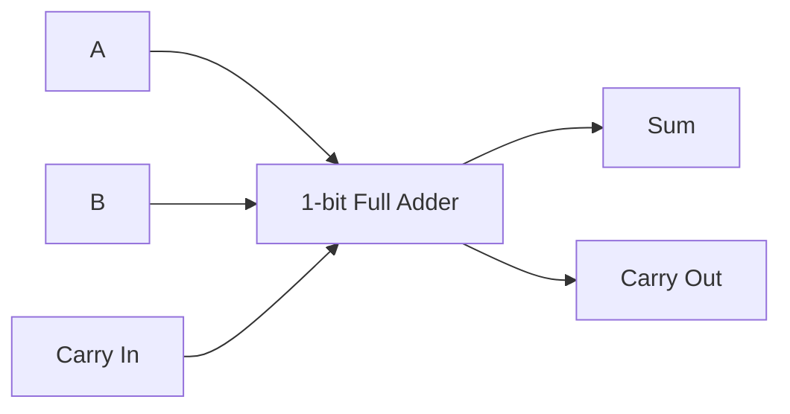

# Comparative Analysis of 1-Bit Full Adders

## Aim
Design and compare three 1-bit full-adder implementations using Verilog:
1. Gate-level using XOR, AND and OR gates
2. Dataflow using Boolean expressions
3. MUX-based carry implementation

## Truth table

| A | B | Cin | Sum | Cout |
|---|---|---|---|---|
| 0 | 0 | 0 | 0 | 0 |
| 0 | 0 | 1 | 1 | 0 |
| 0 | 1 | 0 | 1 | 0 |
| 0 | 1 | 1 | 0 | 1 |
| 1 | 0 | 0 | 1 | 0 |
| 1 | 0 | 1 | 0 | 1 |
| 1 | 1 | 0 | 0 | 1 |
| 1 | 1 | 1 | 1 | 1 |

## Block diagram



## Implementations
- **Gate-level:** two XOR, two AND and one OR gate.
- **Dataflow:** `Sum = A ^ B ^ Cin`; `Cout = (A & B) | (B & Cin) | (A & Cin)`.
- **MUX-based carry:** `Sum = A ^ B ^ Cin`; `Cout = A ? (B | Cin) : (B & Cin)`.

## Comparison
The testbench checks all 8 input combinations and compares Sum and Carry outputs. All implementations should produce identical outputs.

This project performs functional comparison only. Actual area, power and delay require synthesis using the same target cell library and constraints; no measured PPA results are claimed here.

## Run in VS Code terminal
Install Icarus Verilog, then run:

```bash
iverilog -o fa_test full_adder.v full_adder_tb.v
vvp fa_test
```

Expected final message: `ALL FULL ADDER TESTS PASSED`.

Optional waveform:

```bash
iverilog -o fa_wave -D DUMP_WAVE full_adder.v full_adder_tb.v
vvp fa_wave
gtkwave full_adder.vcd
```

## Files
- `full_adder.v` — three implementations
- `full_adder_tb.v` — testbench
- `README.md` — theory, truth table, diagram and instructions

## Conclusion
Three Verilog descriptions of a 1-bit full adder are compared using exhaustive functional simulation of all possible inputs.
